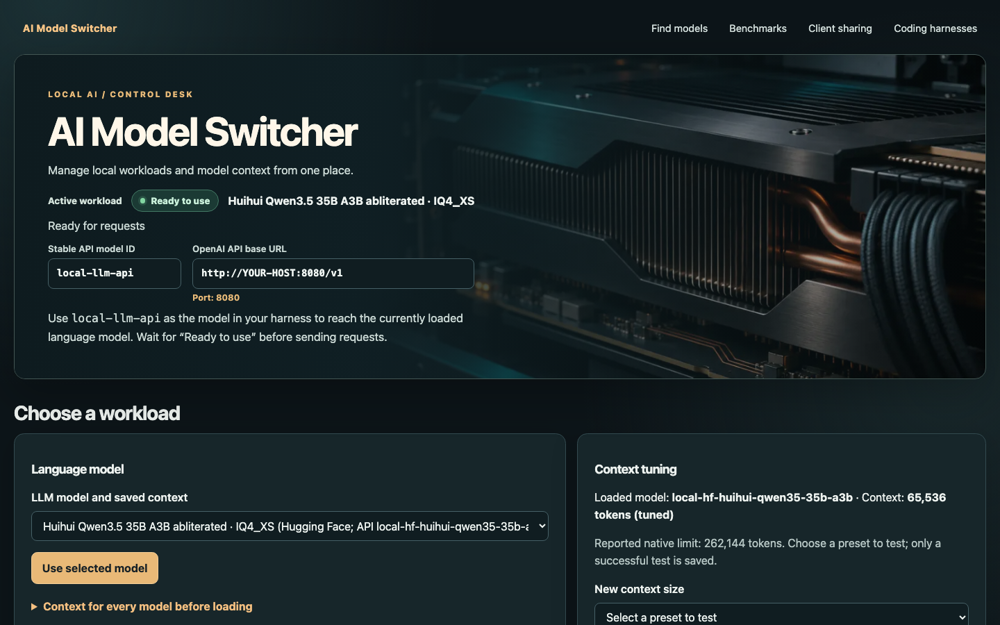
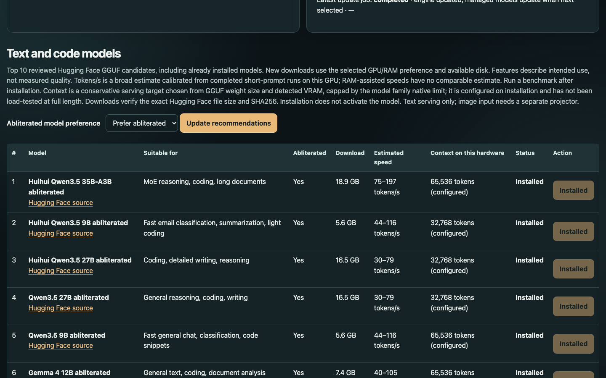
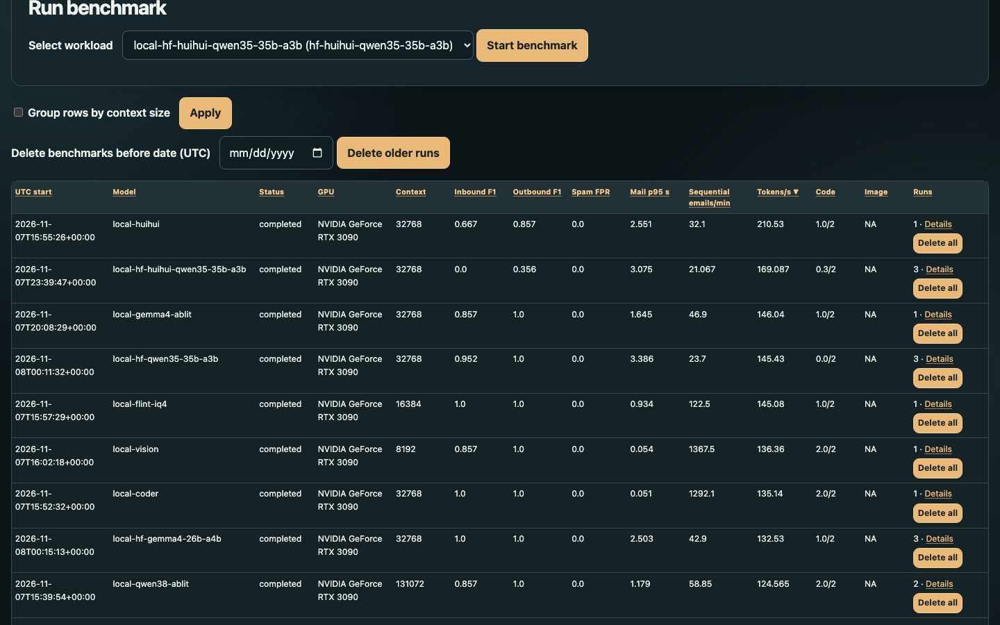
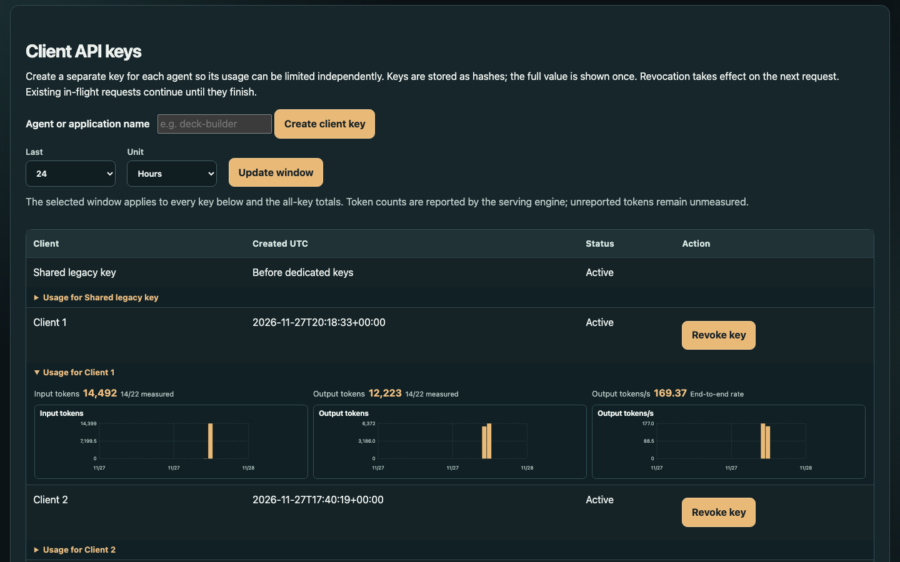

# AI Model Switcher

The optional [multimodal task profiles](docs/MULTIMODAL.md) add persistent PDF/OCR, audio, and ComfyUI image jobs behind the same authenticated API origin. Text clients continue to use `local-llm-api`.

An all-in-one Ubuntu 24.04 installation for local AI. It runs an OpenAI-compatible LLM API, Open WebUI, and a browser-based model switcher behind Nginx. On compatible NVIDIA hardware, selected GPU models and ComfyUI are available too. The switcher manages model selection, hardware-aware recommendations, benchmark history, context and generation-slot tuning, client limits, and live GPU metrics when a GPU is available.

No GPU is required. The installer measures host RAM and, when present, NVIDIA VRAM and CUDA compatibility. It offers CPU and compatible NVIDIA workload choices; AMD and Intel owners can add GGUF models through the switcher's Vulkan path after installation. It downloads no model until you select one or more at the installation prompt; at least one text or vision model is required. ComfyUI is optional and its image/video model files are chosen separately later.

## Screenshots

Captured from a running Ubuntu installation. The host address and client names are masked; available models and benchmark values depend on the hardware and workloads you install.

### Switch models and tune context



### Find models for the detected hardware



### Compare benchmark results



### Manage client keys and usage



The **Coding harnesses** page links to official installation and local API guides for Hermes Agent, OpenCode, Pi, Aider, Cline, and Goose, with strengths and tradeoffs for each. It also shows an OpenCode 2.x provider configuration for `~/.config/opencode/opencode.json` using this installation's API URL and stable model ID.

## Quick start

On the Ubuntu host, copy the generated `ai-setup.sh` and run it as your normal user:

```bash
chmod +x ai-setup.sh
./ai-setup.sh
```

On a compatible NVIDIA host, the first run may install a driver and ask for a reboot. Run the same command again after reboot. The script installs Docker, adds the NVIDIA container runtime only when needed, shows the matching model menu, downloads only your selections, writes the Compose stack under `~/ai_setup` by default, and starts the first selected model. Downloads can take considerable time and disk space. For an unattended install, set `AI_MODEL_SELECTION=cpu-tiny,cpu-4b` (or other IDs shown in the menu). Rerunning keeps an existing valid selection; set `AI_MODEL_SELECTION` to change it.

The script prints the URLs when ready. With the default ports, substitute your Ubuntu host's LAN address:

| Service | URL |
| --- | --- |
| OpenAI-compatible API | `http://HOST:8080/v1` |
| Open WebUI | `http://HOST:3000` |
| AI Model Switcher | `http://HOST:3001` |
| ComfyUI, if selected and active | `http://HOST:8188` |

The switcher and ComfyUI use HTTP Basic authentication. The username is `operator`; get the generated password from the installed controller with `~/ai_setup/ai-control.sh switch-password`. Get the existing API key with `~/ai_setup/ai-control.sh key`. The switcher can create separate, revocable keys for individual agents under **Client sharing**.

The switcher's **Find models** page searches public Hugging Face repositories across publishers. It offers single GGUF files, complete GGUF shard sets, and Safetensors repositories with standard configuration and tokenizer files. GGUF runs through llama.cpp on NVIDIA CUDA, AMD/Intel Vulkan when a render device is available, or CPU. Safetensors runs through vLLM on NVIDIA CUDA or CPU. **GPU + system RAM** is enabled by default for new installs: a model exceeding VRAM can use RAM-assisted llama.cpp placement or calculated vLLM CPU weight offload when the estimated combined budget fits. This is slower than keeping weights in VRAM, and it is not physical pooled memory. The selected model is staged and checksum-verified before a stopped serving container is created. **Try anyway** overrides the memory estimate only; disk capacity, file integrity, and engine compatibility remain required. Gated repositories and separate vision projector files are excluded. Model-specific custom Python code is not enabled.

The same page can uninstall switcher-managed Hugging Face text models after you switch away from them. It removes their files and serving containers while retaining benchmark history. Installer-selected built-in models and shared ComfyUI files need separate manual review.

New Hugging Face installations use readable API IDs derived from their model names. Existing IDs remain stable unless you explicitly change one on an inactive model. Text and ComfyUI downloads queue when another download of the same type is running. Progress updates in place without full-page reloads. The **Client sharing** page shows an initially collapsed usage row beneath every API key and cumulative input/output token totals and effective output tokens/s across all issued keys. Open a key's row to see its compact stats. One selected time window applies to every row. The all-key graphs also appear below the live GPU graph on the home page. Usage and GPU plots have labeled axes and a light grid; missing engine usage is labeled unmeasured.

The home page shows **Loading model** until the active model responds through the API, then **Ready to use**. It displays a copyable API base URL and stable model ID `local-llm-api` for harnesses and other clients; the gateway maps that ID to whichever language model is active. The switcher and proxy show themed error pages if a request fails.

## What is in this repository

- `ai-setup.sh` is the generated, standalone installer. It embeds the Compose file, controller, gateway, assets, and helper scripts.
- `ai-setup.base.sh` and `build_installer.py` are the source and generator for that installer; `install_profile.py`, `install_models.sh`, and `start-selected.sh` implement model selection, selective downloads, and initial startup.
- `server.py` and its companion Python modules implement the switcher, catalog, benchmarks, updates, tuning, and API sharing.
- `fairness_gateway.py` forwards API requests with per-client limits and streaming support.
- `docker-compose.yml`, `nginx.conf`, and `comfyui.Dockerfile` define the installed services.
- `tests/` contains the local test suite.

For installation details, storage locations, and upgrades, see [Installation](docs/INSTALLATION.md). For daily use, see [Operations](docs/OPERATIONS.md). For the service map, see [Architecture](docs/ARCHITECTURE.md). For source changes and tests, see [Development](docs/DEVELOPMENT.md). For credentials and network exposure, see [Security](SECURITY.md).

## Project state

The earlier GPU stack was verified on one Ubuntu 24.04 host with a single RTX 3090. CPU, AMD Vulkan, Intel Vulkan, and vLLM Safetensors paths have automated tests but still need end-to-end tests on representative hardware. Model architecture compatibility is checked when the serving engine loads; a complete repository does not guarantee that vLLM supports its architecture. CI checks syntax, installer generation, and unit/integration tests without a GPU.
