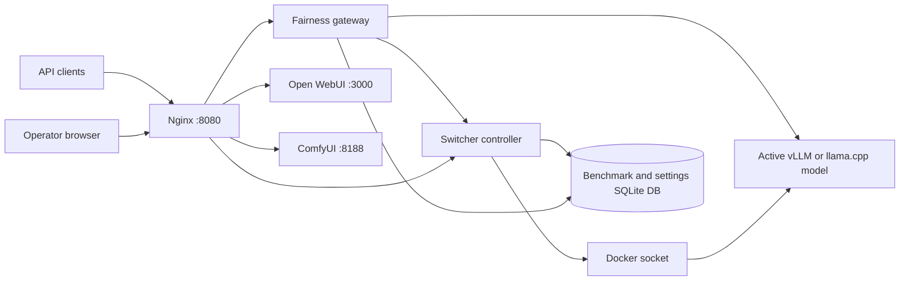

# Architecture

Nginx exposes the LAN ports and protects the switcher and ComfyUI with Basic Auth. The API gateway checks a client key, applies the configured rate and concurrency limits, and streams accepted requests to the active model. It asks the controller which model backend is active. The controller manages containers through the Docker socket and stores benchmarks, installed-model metadata, client-key hashes, and tuning status in SQLite.

Open WebUI connects to the API through Nginx. The installer offers CPU inference without a GPU and adds GPU profiles only when compatible hardware is detected. It records selected model IDs in `.env`, downloads only those model files, and creates their containers; one selected text or vision model starts initially. The switcher can also search Hugging Face for a specific public GGUF, verify its size and SHA256, and create a stopped CPU or GPU llama.cpp container. Memory estimates can be overridden explicitly, while disk capacity and file integrity remain required. ComfyUI is an optional, separate GPU workload. The switcher stops conflicting workloads when changing the active model. Most data stays outside the source tree: model caches and media are host directories, Open WebUI has a Docker volume, and the SQLite database sits in the installed `gpu_control/results` directory.

An optional host-specific HTTPS listener can be included in Nginx for a restricted client such as a mail service. Its certificates, allowlist, and credentials are local configuration and are not included in this repository.
